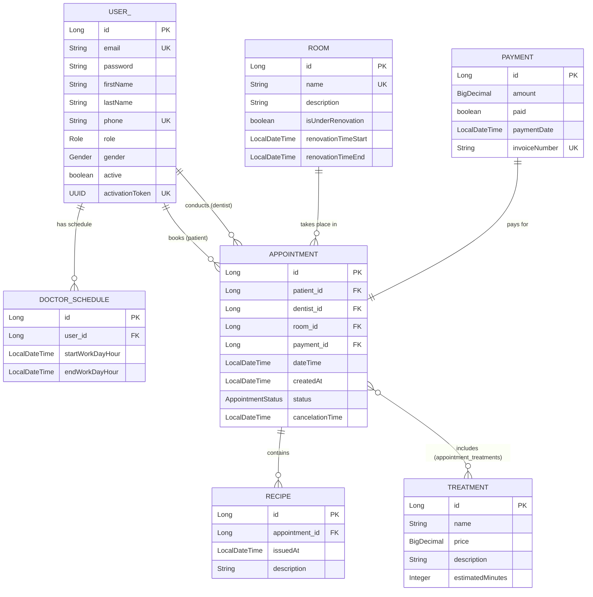

# 🦷 Radwańska-Dent — System Zarządzania Kliniką Stomatologiczną / Dental Clinic Management System


🌍 **Język / Language:** [🇵🇱 Wersja polska](#-wersja-polska) | [🇬🇧 English version](#-english-version)

---

## 🇵🇱 Wersja polska

Projekt zrealizowany w ramach przedmiotu **Kontenery aplikacyjne dla platformy Java EE (KAPJ)**.  
**Radwańska-Dent** to wielowarstwowa aplikacja webowa oparta o klasyczny **Spring Framework 6 (bez Spring Boota)** wdrażana jako archiwum `.war` na kontener serwletów **Apache Tomcat 10.1+ (Jakarta EE 10)**. System kompleksowo wspiera proces rejestracji pacjentów, rezerwacji wizyt stomatologicznych, zarządzania grafikami lekarzy i gabinetami oraz generowania dokumentacji medycznej i finansowej w formacie PDF.

### ✨ Główne funkcjonalności

#### 👤 Strefa publiczna i bezpieczeństwo
- **Rejestracja z weryfikacją Google reCAPTCHA v2** oraz aktywacją konta poprzez unikalny link z tokenem `UUID` wysyłany asynchronicznie na adres e-mail.
- **Uwierzytelnianie oparte o tokeny JWT (JSON Web Token)** obsługiwane zarówno przez bezpieczne ciasteczka `HttpOnly` (`SameSite=Lax`), jak i nagłówek `Authorization: Bearer <token>`.
- **Kontrola dostępu oparta o role (RBAC)** na poziomie filtrów HTTP (`SecurityFilterChain`), metod kontrolerów (`@PreAuthorize`) oraz widoków (`sec:authorize`).
- **Pełna internacjonalizacja (i18n)** — dynamiczne przełączanie języka interfejsu oraz komunikatów walidacji i błędów między językiem **polskim (PL)** a **angielskim (EN)**.

#### 🧑‍💼 Pacjent (`ROLE_CLIENT`)
- Przeglądanie oferty zabiegów stomatologicznych (wraz z czasem trwania i cennikiem) oraz listy specjalistów.
- **Inteligentna rezerwacja wizyt** — wybór jednego lub wielu zabiegów oraz dnia wizyty, po którym system automatycznie wylicza dostępne 30-minutowe okna czasowe u poszczególnych lekarzy z uwzględnieniem:
  - godzin dyżurów lekarzy,
  - łącznego czasu trwania wybranych zabiegów,
  - dostępności wolnych gabinetów (z wykluczeniem gabinetów będących w trakcie remontu),
  - kolizji z innymi wizytami lekarza i pacjenta.
- **Opłacanie zarezerwowanych wizyt** oraz możliwość odwołania wizyty (do 30 minut przed jej rozpoczęciem).
- **Pobieranie faktur PDF** za opłacone wizyty oraz **recept PDF** wystawionych przez lekarza.

#### 🩺 Lekarz (`ROLE_DENTIST`)
- Podgląd i zarządzanie własnym grafikiem dyżurów (edycja i usuwanie dyżurów z walidacją braku zaplanowanych wizyt oraz zachowaniem minimum 1-dniowego wyprzedzenia).
- Przegląd zaplanowanych oraz archiwalnych wizyt przypisanych pacjentów.
- Oznaczanie opłaconych wizyt jako zrealizowane (`COMPLETED`) lub ich odwoływanie (`CANCELLED`) z automatycznym powiadomieniem mailowym pacjenta.
- **Wystawianie recept lekarskich** do opłaconych wizyt oraz generowanie ich podglądu w formacie **PDF**.

#### 🛠️ Administrator (`ROLE_ADMIN`)
- **Dashboard analityczny** z podsumowaniem przychodów (zrealizowanych oraz opłaconych), liczby wizyt oraz statystyk obłożenia gabinetów — odświeżany asynchronicznie przez **REST API (`fetch`)** w formatach **JSON** oraz **XML**.
- Zarządzanie kontami użytkowników (aktywacja / dezaktywacja, usuwanie kont bez historii wizyt).
- Zarządzanie gabinetami stomatologicznymi wraz z planowaniem okresów remontowych (`renovationTimeStart` – `renovationTimeEnd`).
- Zarządzanie cennikiem i katalogiem zabiegów stomatologicznych.
- Zarządzanie grafikami pracy wszystkich lekarzy oraz pełny nadzór nad wizytami, płatnościami, fakturami i receptami.

#### ⚙️ Procesy w tle i współbieżność
- **Asynchroniczna wysyłka powiadomień e-mail (`@Async`)** — potwierdzenia rejestracji, rezerwacji, opłacenia, odwołania wizyty oraz wystawienia recepty realizowane przez dedykowaną pulę wątków `ThreadPoolTaskExecutor`.
- **Zadania cykliczne (`@Scheduled`)** — automatyczne anulowanie nieopłaconych rezerwacji (`PENDING_PAYMENT`) po upływie 2 minut od utworzenia oraz automatyczna zmiana statusu odbytych wizyt na `COMPLETED`.
- **Blokady pesymistyczne (`@Lock(LockModeType.PESSIMISTIC_WRITE)`)** — ochrona przed wyścigiem wątków (*Race Condition*) przy jednoczesnej rezerwacji tego samego terminu lub gabinetu przez wielu pacjentów.

---

### 🧰 Stos technologiczny

| Warstwa / Obszar | Technologia | Wersja |
| :--- | :--- | :--- |
| **Język i platforma** | Java (JDK) / Jakarta Servlet API | 17 / 6.0.0 |
| **Framework aplikacyjny** | Spring Framework (Web MVC, Context, ORM) | 6.1.13 |
| **Bezpieczeństwo** | Spring Security + JJWT (`io.jsonwebtoken`) | 6.3.4 / 0.12.6 |
| **Warstwa utrwalania (ORM)** | Hibernate ORM + Spring Data JPA | 6.5.3.Final / 3.3.4 |
| **Baza danych i pula połączeń** | PostgreSQL + HikariCP | 42.7.4 / 5.1.0 |
| **Silnik szablonów (Widoki)** | Thymeleaf + Thymeleaf Spring Security 6 + Bootstrap 5 | 3.1.2.RELEASE / 5.3.3 |
| **Walidacja danych** | Jakarta Bean Validation + Hibernate Validator + Apache Commons Validator | 3.0.2 / 8.0.1 / 1.10.1 |
| **Generowanie dokumentów PDF** | iTextPDF (z obsługą polskich znaków UTF-8 / `Roboto`) | 5.5.13.5 |
| **Serializacja REST (JSON / XML)** | Jackson Databind + Jackson Dataformat XML | 2.17.2 |
| **Obsługa poczty e-mail** | Jakarta Mail (Eclipse Angus Mail) | 2.0.3 |
| **Budowanie projektu** | Apache Maven (`war`) | 3.x |

---

### 🗂️ Architektura i struktura pakietów

Projekt został zaprojektowany w oparciu o architekturę warstwową oraz czystą konfigurację w klasach Java (`Java-based Configuration`, bez pliku `web.xml` i bez Spring Boota):

```text
src/main/java/pl/kapj/dent/radwanskadent/
├── config/          # Konfiguracja Spring MVC, Security, JWT, Hibernate/JPA, HikariCP, JavaMail, i18n, Async
├── constants/       # Stałe walidacyjne oraz formaty dat i czasu
├── controller/      # Kontrolery widoków (@Controller) oraz kontrolery REST API (@RestController)
├── dto/             # Obiekty transferu danych (Data Transfer Objects) z adnotacjami walidacji
├── exception/       # Globalna obsługa wyjątków (@ControllerAdvice - GlobalExceptionHandler)
├── mapper/          # Mappery przekształcające encje JPA na obiekty DTO
├── model/           # Encje bazodanowe JPA (@Entity) oraz typy wyliczeniowe (Role, Gender, AppointmentStatus)
├── repository/      # Repozytoria Spring Data JPA (zapytania JPQL, blokady pesymistyczne, paginacja)
├── service/         # Interfejsy oraz implementacje logiki biznesowej (@Service, @Transactional, @Scheduled, @Async)
├── utils/           # Klasy narzędziowe (m.in. generator dokumentów PDF dla faktur i recept)
└── validator/       # Niestandardowe walidatory Springa (UserValidator)
```

---

### 🗄️ Model bazy danych (ERD)



---

### 🌐 Główne endpointy aplikacji

#### Kontrolery REST (`@RestController`)
| Metoda | Ścieżka | Opis | Dostęp |
| :--- | :--- | :--- | :--- |
| `POST` | `/api/auth/login` | Logowanie użytkownika (zwraca token JWT w JSON oraz ustawia ciasteczko `JWT_TOKEN`) | Publiczny |
| `GET` | `/api/stats` | Statystyki kliniki (obsługuje `application/json` oraz `application/xml`) | `ADMIN` |
| `GET` | `/invoice/generate/{userId}?appointmentId={id}` | Generowanie i pobieranie faktury w formacie PDF | `ADMIN`, `CLIENT` |
| `GET` | `/recipe/pdf/{recipeId}` | Generowanie i pobieranie recepty lekarskiej w formacie PDF | `ADMIN`, `DENTIST`, `CLIENT` |

#### Kontrolery widoków (`@Controller`)
| Ścieżka bazowa | Kontroler | Opis | Dostęp |
| :--- | :--- | :--- | :--- |
| `/`, `/home`, `/login` | `HomeController` | Strona główna z ofertą i karuzelą specjalistów, formularz logowania | Publiczny |
| `/user/**` | `UserController` | Rejestracja, aktywacja konta przez e-mail, edycja profilu i hasła | Publiczny / Zalogowani |
| `/appointment/**` | `AppointmentController` | Wyszukiwanie wolnych terminów, rezerwacja, opłacanie i odwoływanie wizyt | `CLIENT` |
| `/dentist/**` | `DentistController` | Panel lekarza: zarządzanie dyżurami, realizacja wizyt, wystawianie recept | `DENTIST` |
| `/admin/**` | `AdminController` | Panel administratora: statystyki, użytkownicy, gabinety, zabiegi, grafiki, wizyty | `ADMIN` |

---

### 🚀 Instrukcja uruchomienia

1. **Wymagania wstępne:** JDK 17+, Apache Maven 3.8+, PostgreSQL 14+, Apache Tomcat 10.1+ (Jakarta EE 10 / Servlet 6.0).
2. **Konfiguracja (`src/main/resources/application.properties`):**
   ```properties
   # Baza danych PostgreSQL
   db.driver=org.postgresql.Driver
   db.url=jdbc:postgresql://localhost:5432/radwanska_dent
   db.username=postgres
   db.password=twoje_haslo

   # Konfiguracja serwera pocztowego SMTP
   mail.host=smtp.poczta.onet.pl
   mail.username=twoj_email@op.pl
   mail.password=twoje_haslo_smtp

   # Konfiguracja Google reCAPTCHA v2
   recaptcha.url=https://www.google.com/recaptcha/api/siteverify
   recaptcha.site-key=TWOJ_SITE_KEY
   recaptcha.secret=TWOJ_SECRET_KEY

   # Konfiguracja JWT
   jwt.secret=bXktdmVyeS1zZWNyZXQta2V5LWZvci1yYWR3YW5za2EtZGVudC0yMDI2LWthcGotcHJvamVjdA==
   jwt.expiration=86400000
   jwt.cookie-secure=false
   ```
3. **Budowanie i wdrożenie:**
   ```bash
   mvn clean package
   ```
   Wygenerowany plik `target/radwanska-dent-1.0-SNAPSHOT.war` należy wdrożyć na serwerze **Apache Tomcat 10.1+**. Schemat bazy danych zostanie utworzony/zaktualizowany automatycznie przy starcie dzięki Hibernate (`hibernate.hbm2ddl.auto=update`).

---
---

## 🇬🇧 English Version

A project developed for the **Application Containers for the Java EE Platform (KAPJ)** course.  
**Radwańska-Dent** is a multi-layered web application built with **pure Spring Framework 6 (without Spring Boot)** and deployed as a `.war` archive on an **Apache Tomcat 10.1+ (Jakarta EE 10)** servlet container. The system provides end-to-end support for patient registration, dental appointment booking, doctor schedule and treatment room management, as well as generating medical prescriptions and financial invoices in PDF format.

### ✨ Key Features

#### 👤 Public Zone & Security
- **User registration with Google reCAPTCHA v2 verification** and account activation via a unique `UUID` token link sent asynchronously by email.
- **Stateless JWT (JSON Web Token) authentication** supported via both secure `HttpOnly` cookies (`SameSite=Lax`) and the `Authorization: Bearer <token>` HTTP header.
- **Role-Based Access Control (RBAC)** enforced at the HTTP filter level (`SecurityFilterChain`), controller method level (`@PreAuthorize`), and view layer (`sec:authorize`).
- **Full Internationalization (i18n)** — seamless switching of UI labels, validation messages, and business error notifications between **Polish (PL)** and **English (EN)**.

#### 🧑‍💼 Patient (`ROLE_CLIENT`)
- Browse available dental treatments (with estimated duration and pricing) and view the clinic's specialists.
- **Smart Appointment Booking** — select one or multiple treatments and a preferred date to automatically compute available 30-minute time slots for each dentist based on:
  - doctors' working hours (`DoctorSchedule`),
  - total duration of the selected treatments,
  - availability of treatment rooms (excluding rooms currently under renovation),
  - conflict detection against existing appointments for both the dentist and the patient.
- **Online appointment payment simulation** and appointment cancellation (allowed up to 30 minutes before the scheduled start time).
- **Download PDF Invoices** for paid appointments and **PDF Prescriptions** issued by the dentist.

#### 🩺 Dentist (`ROLE_DENTIST`)
- View and manage personal shift schedules (update or delete shifts with validation ensuring no appointments are booked on that day and enforcing a minimum 1-day advance notice).
- Browse upcoming and historical patient appointments with pagination.
- Mark paid appointments as `COMPLETED` or cancel them (`CANCELLED`) with automatic email notifications sent to the patient.
- **Issue medical prescriptions** for paid appointments and generate downloadable **PDF prescriptions**.

#### 🛠️ Administrator (`ROLE_ADMIN`)
- **Live Analytics Dashboard** displaying completed revenue, total paid revenue, appointment counts, and room utilization statistics — refreshed asynchronously via **REST API (`fetch`)** supporting both **JSON** and **XML** formats.
- User management (activate/deactivate accounts, delete users without appointment history).
- Dental room management, including scheduling renovation periods (`renovationTimeStart` – `renovationTimeEnd`).
- Dental treatment catalog and price list management.
- Full oversight of doctors' work schedules, appointments, payments, invoices, and prescriptions.

#### ⚙️ Background Processing & Concurrency
- **Asynchronous Email Notifications (`@Async`)** — account activation links, booking confirmations, payment receipts, cancellation alerts, and prescription notifications are processed via a dedicated `ThreadPoolTaskExecutor`.
- **Scheduled Background Tasks (`@Scheduled`)** — automatic cancellation of unpaid reservations (`PENDING_PAYMENT`) after 2 minutes and automatic completion (`COMPLETED`) of past confirmed appointments.
- **Pessimistic Database Locking (`@Lock(LockModeType.PESSIMISTIC_WRITE)`)** — prevents race conditions when multiple patients attempt to book the same doctor or room at the exact same time.

---

### 🧰 Technology Stack

| Layer / Area | Technology | Version |
| :--- | :--- | :--- |
| **Language & Runtime** | Java (JDK) / Jakarta Servlet API | 17 / 6.0.0 |
| **Application Framework** | Spring Framework (Web MVC, Context, ORM) | 6.1.13 |
| **Security & Auth** | Spring Security + JJWT (`io.jsonwebtoken`) | 6.3.4 / 0.12.6 |
| **Persistence (ORM)** | Hibernate ORM + Spring Data JPA | 6.5.3.Final / 3.3.4 |
| **Database & Connection Pool** | PostgreSQL + HikariCP | 42.7.4 / 5.1.0 |
| **Template Engine & UI** | Thymeleaf + Thymeleaf Spring Security 6 + Bootstrap 5 | 3.1.2.RELEASE / 5.3.3 |
| **Validation** | Jakarta Bean Validation + Hibernate Validator + Apache Commons Validator | 3.0.2 / 8.0.1 / 1.10.1 |
| **PDF Generation** | iTextPDF (with custom UTF-8 `Roboto` font support) | 5.5.13.5 |
| **REST Serialization (JSON / XML)** | Jackson Databind + Jackson Dataformat XML | 2.17.2 |
| **Email Service** | Jakarta Mail (Eclipse Angus Mail) | 2.0.3 |
| **Build Tool** | Apache Maven (`war`) | 3.x |

---

### 🗂️ Project Architecture

The application follows a clean layered architecture configured entirely via Java classes (`Java-based Configuration`, no `web.xml` descriptors and no Spring Boot auto-configuration):

```text
src/main/java/pl/kapj/dent/radwanskadent/
├── config/          # Spring MVC, Security, JWT Filter, Hibernate/JPA, HikariCP, JavaMail, i18n, Async config
├── constants/       # Validation constants and date/time formatters
├── controller/      # MVC View Controllers (@Controller) and REST API Controllers (@RestController)
├── dto/             # Data Transfer Objects with Bean Validation constraints
├── exception/       # Centralized exception handling (@ControllerAdvice - GlobalExceptionHandler)
├── mapper/          # Entity-to-DTO mappers
├── model/           # JPA Entities (@Entity) and domain enums (Role, Gender, AppointmentStatus)
├── repository/      # Spring Data JPA repositories (JPQL queries, pessimistic locks, pagination)
├── service/         # Business logic interfaces and implementations (@Service, @Transactional, @Scheduled, @Async)
├── utils/           # Utility classes (e.g., PDF generator for invoices and medical prescriptions)
└── validator/       # Custom Spring Validator (UserValidator)
```

---

### 🌐 Main Application Endpoints

#### REST Controllers (`@RestController`)
| Method | Endpoint | Description | Access |
| :--- | :--- | :--- | :--- |
| `POST` | `/api/auth/login` | Authenticates user, returns JWT token in JSON body & sets `JWT_TOKEN` cookie | Public |
| `GET` | `/api/stats` | Returns clinic statistics (supports `application/json` and `application/xml`) | `ADMIN` |
| `GET` | `/invoice/generate/{userId}?appointmentId={id}` | Generates and downloads a PDF invoice for a paid appointment | `ADMIN`, `CLIENT` |
| `GET` | `/recipe/pdf/{recipeId}` | Generates and downloads a PDF medical prescription | `ADMIN`, `DENTIST`, `CLIENT` |

#### View Controllers (`@Controller`)
| Base Path | Controller | Description | Access |
| :--- | :--- | :--- | :--- |
| `/`, `/home`, `/login` | `HomeController` | Landing page with treatments, specialists carousel, and login page | Public |
| `/user/**` | `UserController` | User registration, email activation, profile & password management | Public / Authenticated |
| `/appointment/**` | `AppointmentController` | Available slot search, booking, payment, and cancellation | `CLIENT` |
| `/dentist/**` | `DentistController` | Dentist dashboard: shift management, appointment completion, prescriptions | `DENTIST` |
| `/admin/**` | `AdminController` | Admin dashboard: live stats, users, rooms, treatments, schedules, appointments | `ADMIN` |

---

### 🚀 Getting Started

1. **Prerequisites:** JDK 17+, Apache Maven 3.8+, PostgreSQL 14+, Apache Tomcat 10.1+ (Jakarta EE 10 / Servlet 6.0).
2. **Configuration (`src/main/resources/application.properties`):**
   Configure your PostgreSQL database credentials, SMTP mail server, Google reCAPTCHA v2 keys, and JWT secret in `src/main/resources/application.properties`.
3. **Build & Deploy:**
   ```bash
   mvn clean package
   ```
   Deploy the generated `target/radwanska-dent-1.0-SNAPSHOT.war` archive to **Apache Tomcat 10.1+**. The database schema is automatically initialized/updated on startup via Hibernate (`hibernate.hbm2ddl.auto=update`).
